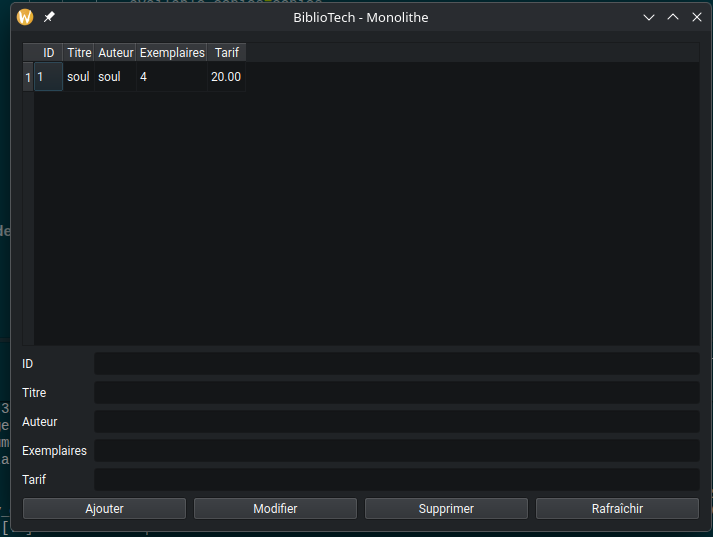

# BiblioTech - Partie 1 : Version monolithique

## Lancement
1. Se placer dans le dossier du projet
cd ~/Desktop/lab1/tp/bibliotech_squelette

2. Démarrer la base de données PostgreSQL
sudo docker compose up -d

3. Activer l'environnement virtuel Python
source ~/Desktop/lab1/tp/.venv/bin/activate

4. Lancer l'application BiblioTech
python part1_monolith/app.py

## Q6 - Quelles sont les limites de cette approche monolithique ?

L’approche monolithique présente plusieurs limites, notamment la difficulté de maintenance lorsque le code devient volumineux, la forte dépendance entre les composants, la complexité des tests et la faible réutilisation du code. De plus, l’ajout de nouvelles fonctionnalités peut rendre l’application plus difficile à faire évoluer.
