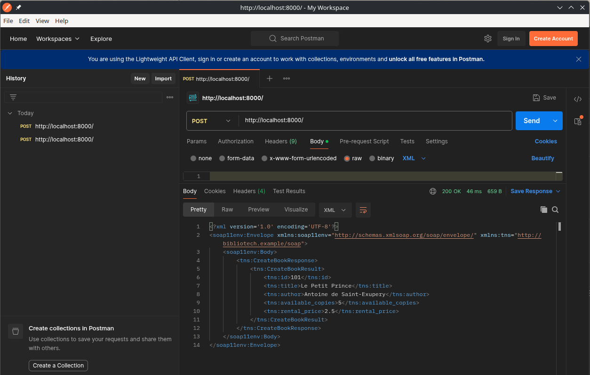
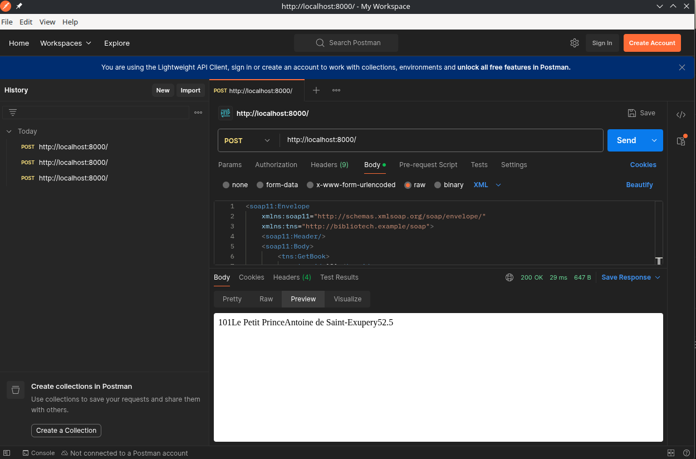
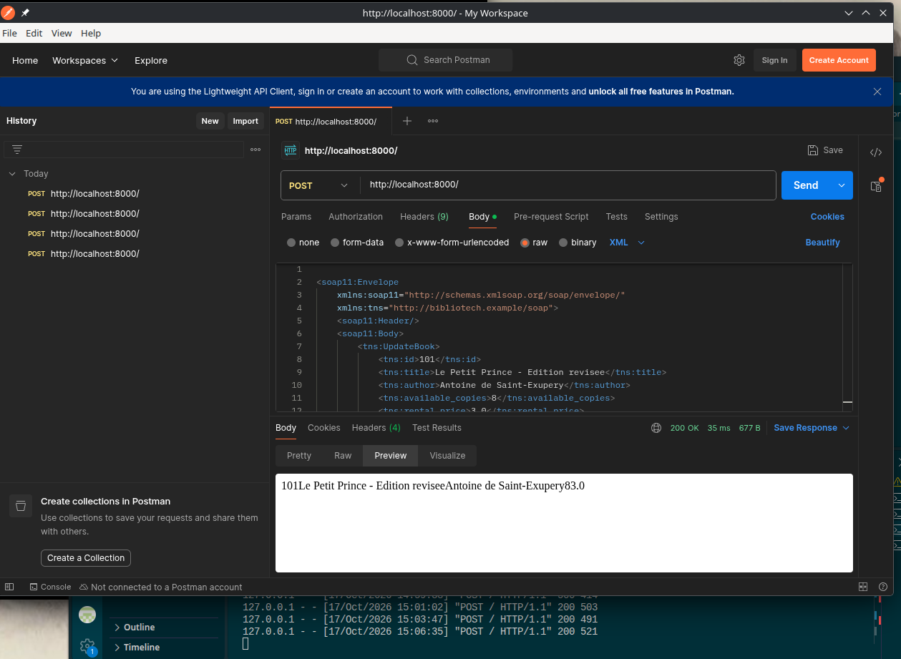
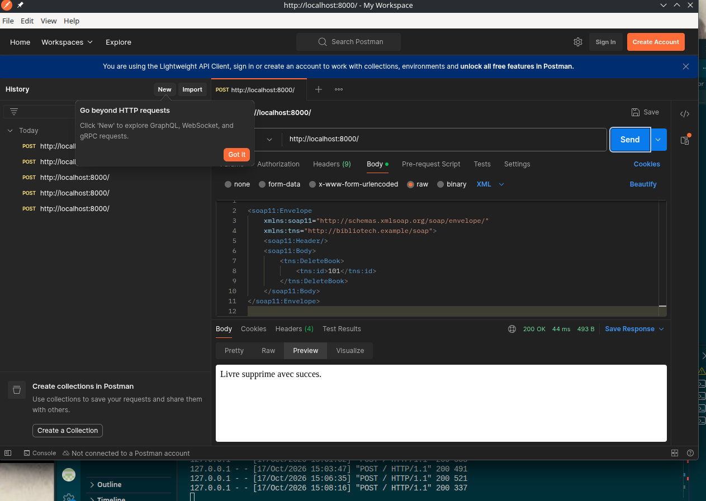

# BiblioTech - Partie 2 : Service Web SOAP

## Lancement
python part2_soap/soap_service.py 
rq: New virtual environment (`.venv311`) for compatibility purposes. 

## WSDL

path : bibliotech_squelette/part2_soap/library.wsdl

## Tests Postman
   

## Q6 - En quoi SOAP impose-t-il davantage de structure et de contrats que le monolithe ?
SOAP impose davantage de structure et de contrats que le monolithe, car il repose sur un format de messages XML standardisé et sur un contrat formel décrit par le WSDL. Ce dernier définit les opérations disponibles, les paramètres attendus, les types de données et les formats des requêtes et des réponses. Le client doit respecter ce contrat pour communiquer avec le service.

Dans un monolithe, les différentes fonctions communiquent généralement directement au sein de la même application, par des appels de fonctions ou de méthodes Python. Les échanges sont donc plus simples et nécessitent moins de configuration.

Avec SOAP, il faut définir les opérations du service, respecter la structure XML des messages et gérer les erreurs retournées sous forme de SOAP Fault. Cette structure rend les échanges plus rigoureux et facilite l'interopérabilité entre des applications développées dans différents langages, mais elle ajoute de la complexité et du code par rapport à un monolithe.
