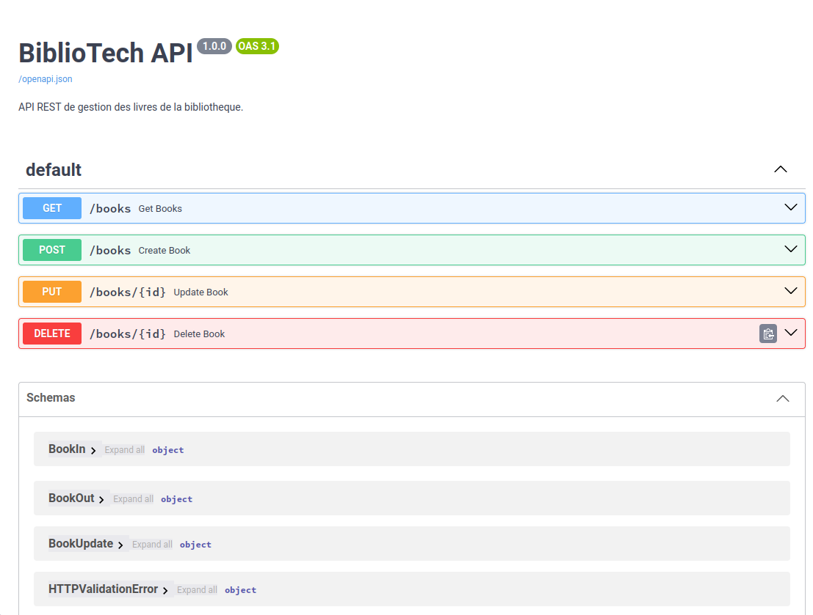
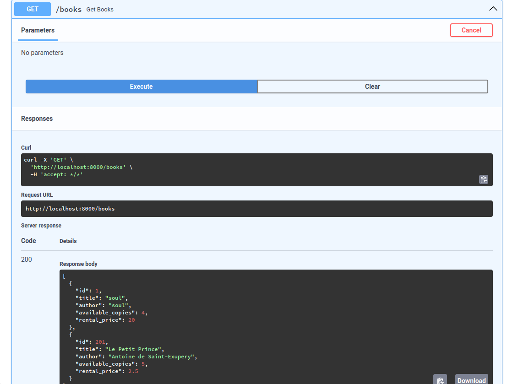

# BiblioTech - Partie 3 : API REST

## Lancement
docker compose up --build

## Documentation OpenAPI

Liste des livres : http://localhost:8000/books

Les opérations CRUD disponibles sont :

GET /books : récupérer la liste des livres.

POST /books : ajouter un livre.

PUT /books/{id} : modifier un livre existant.

DELETE /books/{id} : supprimer un livre.

 

## Q6 - Comparaison SOAP vs REST (lisibilite, facilite d'utilisation, integration)
SOAP : SOAP utilise des messages XML et un contrat WSDL qui définit les opérations disponibles, les paramètres et les types de données. Cette structure facilite les échanges entre systèmes différents et garantit un format de communication précis. Cependant, les messages XML sont relativement longs et la configuration peut être plus complexe.

REST : REST utilise les méthodes HTTP (GET, POST, PUT, DELETE) et échange généralement des données au format JSON. Les requêtes et les réponses sont plus faciles à lire et à tester. Avec FastAPI, la validation des données est assurée par Pydantic et la documentation OpenAPI est générée automatiquement.

Comparaison :

Lisibilité : REST est généralement plus lisible grâce au format JSON, tandis que SOAP utilise un XML plus verbeux.

Facilité d'utilisation : REST est plus simple à tester et à intégrer dans les applications web et mobiles. SOAP impose davantage de conventions et de configuration.

Intégration : SOAP convient aux systèmes nécessitant un contrat formel et des échanges standardisés. REST s'intègre facilement aux applications web grâce aux méthodes HTTP et aux formats courants.

Gestion des erreurs : SOAP définit notamment les erreurs avec les messages SOAP Fault. REST utilise les codes de statut HTTP, par exemple 200, 201, 404 ou 422.
